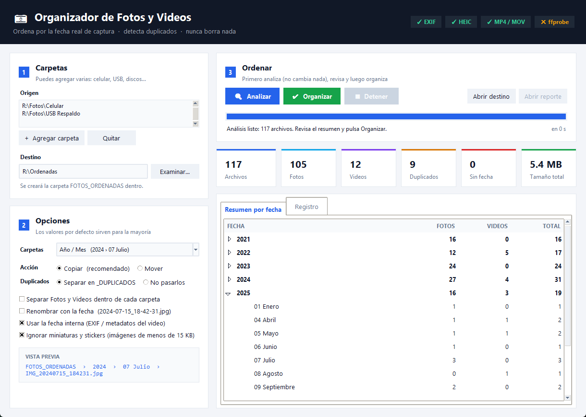
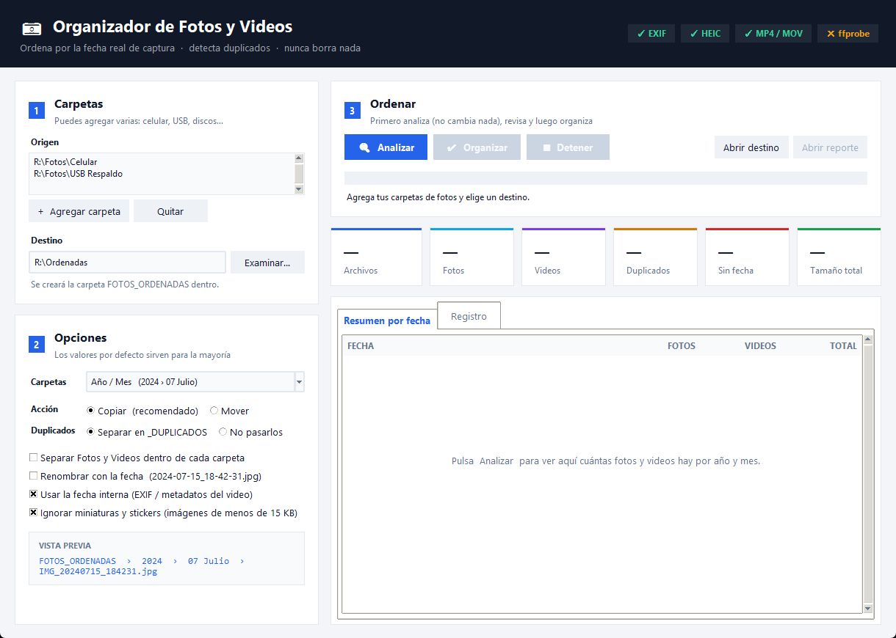

# 📷 Organizador de Fotos y Videos

Ordena automáticamente todas tus fotos y videos en carpetas por **año y mes**, usando la **fecha real en que se tomaron**. Detecta los duplicados y **nunca borra nada**.

Ideal para juntar en un solo lugar las fotos de varios celulares, memorias USB, discos y copias de WhatsApp.



---

## Índice

- [Qué hace](#qué-hace)
- [Requisitos](#requisitos)
- [Instalación](#instalación)
- [Uso paso a paso](#uso-paso-a-paso)
- [Opciones](#opciones)
- [Cómo decide la fecha](#cómo-decide-la-fecha)
- [Qué encontrarás en el destino](#qué-encontrarás-en-el-destino)
- [Reportes](#reportes)
- [Consejos](#consejos)
- [Preguntas frecuentes](#preguntas-frecuentes)
- [Solución de problemas](#solución-de-problemas)
- [Privacidad](#privacidad)
- [Para desarrolladores](#para-desarrolladores)
- [Licencia](#licencia)

---

## Qué hace

- 📂 **Revisa varias carpetas a la vez** (celular, USB, discos…) con todas sus subcarpetas.
- 📅 **Usa la fecha real de captura**, no la fecha en que copiaste el archivo:
  - EXIF de la cámara en las fotos (JPG, HEIC del iPhone, PNG, RAW…).
  - Metadatos internos de los videos MP4 / MOV / 3GP, sin instalar nada extra.
  - La fecha escrita en el nombre (`IMG_20240715_184231.jpg`, `IMG-20240715-WA0001.jpg`, capturas de pantalla…).
- 🔁 **Detecta duplicados por contenido**: aunque tengan otro nombre o estén en otra carpeta.
- 🛡️ **Nunca borra nada**. Por defecto **copia**, así que tus originales no se tocan.
- ♻️ **Se puede usar varias veces**: lo que ya está en el destino no se vuelve a copiar.
- 🧹 **Ignora la basura**: miniaturas (`.thumbnails`), stickers, archivos vacíos y la papelera.
- 📊 **Muestra un resumen antes de hacer cambios** y guarda un reporte CSV de todo lo que hizo.

**Formatos soportados**

| Fotos | Videos |
|---|---|
| JPG, JPEG, PNG, HEIC, HEIF, AVIF, WEBP, GIF, BMP, TIFF, DNG, RAW, CR2, CR3, NEF, ARW, ORF, RW2 | MP4, MOV, M4V, 3GP, 3G2, AVI, MKV, MTS, M2TS, WEBM, WMV, FLV |

---

## Requisitos

- **Windows 10 u 11**.
- **Python 3.9 o más nuevo** (es gratis).
- Espacio libre en el disco de destino. Al **copiar** necesitas tanto espacio como ocupan tus fotos; el programa lo revisa antes de empezar.

---

## Instalación

### 1. Instalar Python (solo una vez)

1. Entra a <https://www.python.org/downloads/> y descarga la última versión.
2. Abre el instalador y **marca la casilla `Add python.exe to PATH`** antes de pulsar *Install Now*.

   > ⚠️ Si no marcas esa casilla, el programa no podrá abrirse.

### 2. Descargar el organizador

1. Descarga el ZIP: **[⬇️ Descargar organizador-fotos](https://github.com/LifeSystemSolution/organizador-fotos/archive/refs/heads/main.zip)**
   (o en esta página: botón verde **Code → Download ZIP**).
2. Haz clic derecho sobre el ZIP → **Extraer todo…** y elige una carpeta, por ejemplo `Documentos`.

### 3. Instalar los complementos (solo una vez)

Dentro de la carpeta extraída, haz doble clic en **`Instalar_Complementos.bat`**.

Instala dos librerías:

- **Pillow**: para leer la fecha EXIF de las fotos.
- **pillow-heif**: para las fotos **HEIC** del iPhone.

Cuando diga *Listo*, cierra esa ventana.

### 4. Abrir el programa

Doble clic en **`Ejecutar_OrganizadorFotos.bat`**.

En la esquina superior derecha verás qué funciones están activas:

| Indicador | Significado |
|---|---|
| ✓ EXIF | Puede leer la fecha de las fotos. |
| ✓ HEIC | Puede leer fotos del iPhone. |
| ✓ MP4 / MOV | Siempre activo. |
| ✕ ffprobe | Opcional, solo para la fecha interna de AVI, MKV, etc. ([ver más](#preguntas-frecuentes)). |

---

## Uso paso a paso



### Paso 1 · Carpetas

1. Pulsa **`+ Agregar carpeta`** y elige una carpeta donde tengas fotos o videos.
   Repite para cada carpeta (copia del celular, USB, otro disco…). Se revisan **todas las subcarpetas**.
2. En **Destino** pulsa **`Examinar…`** y elige dónde guardar el resultado.
   Ahí se creará la carpeta **`FOTOS_ORDENADAS`**.

> 💡 El destino puede estar en otro disco. Si lo eliges dentro de una carpeta de origen, el programa no se escanea a sí mismo.

### Paso 2 · Opciones

Los valores que vienen marcados sirven para la mayoría de personas. Abajo verás una **Vista previa** de cómo quedará cada archivo. Detalle de cada opción en [Opciones](#opciones).

### Paso 3 · Analizar

Pulsa **`🔍 Analizar`**. **No cambia nada**: solo lee tus archivos y te muestra:

- Total de archivos, fotos, videos, duplicados y archivos sin fecha.
- Una tabla con **cuántos archivos hay por año y mes** (despliega cada año con la flechita).
- En la pestaña **Registro**: de dónde sacó la fecha de cada grupo de archivos.

Revisa que los números tengan sentido.

### Paso 4 · Organizar

Pulsa **`✔ Organizar`**, confirma, y espera. La barra muestra el avance y el tiempo restante.
Puedes pulsar **`■ Detener`** en cualquier momento: lo que ya se hizo queda bien hecho y puedes continuar después.

Al terminar te pregunta si quieres abrir la carpeta de destino. También tienes los botones **Abrir destino** y **Abrir reporte**.

### Paso 5 · Revisar

Abre `FOTOS_ORDENADAS`, revisa tus fotos y, **solo cuando estés conforme**, decide qué hacer con los originales.

---

## Opciones

| Opción | Qué hace |
|---|---|
| **Carpetas** | Cómo se arman las carpetas: `2024 › 07 Julio` (por defecto), `2024-07`, `2024 › 07 Julio › 2024-07-15` o solo `2024`. |
| **Copiar** *(recomendado)* | Copia los archivos al destino. Los originales quedan igual. |
| **Mover** | Mueve los archivos al destino (no ocupa espacio extra en el mismo disco). No borra nada: todo queda en el destino y el reporte dice de dónde salió cada archivo. |
| **Separar en _DUPLICADOS** | Las copias repetidas van a la carpeta `_DUPLICADOS` para que las revises. |
| **No pasarlos** | Las copias repetidas no se copian ni se mueven (se quedan donde estaban). |
| **Separar Fotos y Videos** | Dentro de cada mes crea las subcarpetas `Fotos` y `Videos`. |
| **Renombrar con la fecha** | Cambia el nombre a `2024-07-15_18-42-31.jpg` en la copia, así quedan en orden cronológico. |
| **Usar la fecha interna** | Lee EXIF y metadatos de video. Déjalo marcado salvo que tengas una razón para no hacerlo. |
| **Ignorar miniaturas y stickers** | Salta imágenes de menos de 15 KB (stickers de WhatsApp, íconos, miniaturas). Quedan listadas en el reporte de ignorados. |

El programa **recuerda** tus carpetas y opciones para la próxima vez.

---

## Cómo decide la fecha

Para cada archivo prueba en este orden y usa la primera fecha válida:

1. **EXIF de la cámara**: la fecha en que se tomó la foto (`DateTimeOriginal`).
2. **Metadatos del video**: fecha de grabación guardada dentro del MP4/MOV.
3. **Nombre del archivo**: por ejemplo `IMG_20240715_184231`, `VID-20240715-WA0003`, `Screenshot_2024-07-15-18-42-31`.
4. **Fecha del archivo**: la más antigua entre la fecha de creación y la de modificación.

Si ninguna sirve, el archivo va a `_SIN_FECHA`. Se descartan fechas imposibles (antes de 1990 o en el futuro).

---

## Qué encontrarás en el destino

```
FOTOS_ORDENADAS/
├── 2023/
│   ├── 01 Enero/
│   ├── 02 Febrero/
│   └── ...
├── 2024/
│   └── 07 Julio/
│       ├── IMG_20240715_184231.jpg
│       └── VID_20240716_101500.mp4
├── _DUPLICADOS/     ← copias exactas de archivos que ya están ordenados
├── _SIN_FECHA/      ← archivos sin ninguna fecha válida
└── _REPORTES/       ← reportes CSV de cada ejecución
```

Si dos archivos distintos tienen el mismo nombre en la misma carpeta, el segundo se guarda como `nombre_001.jpg`. Nunca se sobrescribe nada.

---

## Reportes

En `FOTOS_ORDENADAS/_REPORTES` se guarda un reporte por cada vez que organizas. Se abren con Excel.

**`REPORTE_fecha_hora.csv`**: una fila por archivo.

| Columna | Contenido |
|---|---|
| `estado` | `copiado`, `movido`, `ya estaba en el destino`, `omitido (duplicado)` o `error: …` |
| `origen` | Dónde estaba el archivo. |
| `destino` | Dónde quedó. |
| `fecha_detectada` | La fecha usada para ordenarlo. |
| `metodo_fecha` | De dónde salió la fecha (EXIF, video, nombre, fecha del archivo). |
| `tipo` | `foto` o `video`. |
| `tamano_MB` | Tamaño del archivo. |
| `duplicado_de` | Si es duplicado, cuál es el archivo original. |

**`IGNORADOS_fecha_hora.csv`**: archivos y carpetas que se saltaron y por qué (miniaturas, vacíos, carpetas de sistema).

> 💡 En Excel usa **Datos → Filtro** sobre la columna `estado` o `metodo_fecha` para revisar rápido.

---

## Consejos

- **Primero pásalo todo a la PC.** Copia las carpetas del celular (normalmente `DCIM` y `WhatsApp/Media` en Android, o importa desde el iPhone con la app *Fotos* de Windows) y luego usa esas carpetas como origen.
- **iPhone:** en *Ajustes → Fotos → Transferir a Mac o PC* elige **Conservar originales** para que pasen como HEIC con su fecha.
- **Usa Copiar la primera vez.** Cuando veas que todo quedó bien, puedes borrar los originales tú mismo.
- **Guarda el destino en otro disco** o haz un respaldo: es tu biblioteca de fotos.
- **¿Agregaste más fotos después?** Vuelve a pulsar *Analizar* y *Organizar* con el mismo destino: solo se agregan las nuevas.

---

## Preguntas frecuentes

**¿Puede borrar mis fotos?**
No. El programa no tiene ninguna función para borrar. Con *Copiar* tus originales quedan intactos; con *Mover* se trasladan al destino, pero nada se elimina.

**¿Qué pasa si lo cierro o se va la luz a la mitad?**
Cada archivo se copia primero como temporal y solo se renombra al terminar, así que no quedan archivos a medias. Vuelve a ejecutarlo: lo que ya estaba en el destino no se repite.

**¿Por qué algunas fotos quedaron en un mes que no corresponde?**
Seguramente no tenían EXIF (por ejemplo, fotos reenviadas por algunas apps) ni fecha en el nombre, y se usó la fecha del archivo. Revisa la columna `metodo_fecha` del reporte: las que dicen *Fecha del archivo* son las menos seguras.

**¿Cómo elige cuál es el original entre dos duplicados?**
Prefiere el que tiene fecha más confiable (EXIF), luego el que no parece copia (`foto (1).jpg`, `copia.jpg`…) y luego la ruta más corta.

**¿Qué es ffprobe y lo necesito?**
Es parte de [FFmpeg](https://ffmpeg.org/download.html). Solo hace falta para leer la fecha interna de videos **AVI, MKV, WMV, etc.** Los MP4 y MOV de celulares funcionan sin él. Si lo instalas y está en el PATH, el programa lo usa automáticamente.

**¿Funciona con discos externos o de red?**
Sí, con cualquier carpeta que Windows pueda abrir. En discos de red será más lento.

**¿Funciona en Mac o Linux?**
Está pensado para Windows. El script de Python funciona en otros sistemas ejecutándolo con `python3 OrganizadorFotos.py`, pero no está probado ahí.

---

## Solución de problemas

| Problema | Solución |
|---|---|
| Al abrir dice *"No se encontró Python"* | Instala Python marcando **Add python.exe to PATH**. Si ya lo tienes, reinstálalo y marca esa casilla. |
| Se abre Microsoft Store al ejecutar | Windows tiene un acceso directo falso a Python. Instala Python desde python.org, o desactiva los alias en *Configuración → Aplicaciones → Configuración avanzada → Alias de ejecución de aplicaciones*. |
| El indicador **EXIF** o **HEIC** aparece con ✕ | Ejecuta `Instalar_Complementos.bat` y vuelve a abrir el programa. |
| *"No hay espacio suficiente en el destino"* | Elige un destino en un disco con más espacio, marca *No pasarlos* en duplicados, o usa *Mover* en el mismo disco. |
| Muchos archivos en `_SIN_FECHA` | Suelen ser imágenes descargadas o editadas sin metadatos. Revísalos a mano. |
| Aparecen errores en el Registro | Suelen ser archivos abiertos en otro programa, sin permisos o dañados. Están en el reporte con `error: …`; cierra el otro programa y vuelve a organizar. |
| *"Cambiaste las carpetas u opciones: vuelve a analizar"* | Cambiaste algo después de analizar. Pulsa *Analizar* otra vez. |

---

## Privacidad

Todo funciona **en tu computadora**. El programa **no se conecta a internet** ni envía tus fotos a ningún lado. Solo guarda tus últimas carpetas y opciones en `%APPDATA%\OrganizadorFotos\config.json`.

---

## Para desarrolladores

Es un único archivo de Python con interfaz Tkinter (incluida en Python).

```bash
python -m pip install Pillow pillow-heif
python OrganizadorFotos.py
```

| Archivo | Para qué es |
|---|---|
| `OrganizadorFotos.py` | El programa: lógica (fechas, duplicados, copia) e interfaz. |
| `Ejecutar_OrganizadorFotos.bat` | Abre el programa con doble clic. |
| `Instalar_Complementos.bat` | Instala Pillow y pillow-heif. |
| `docs/` | Capturas para este manual. |

La lógica (`analyze`, `organize`, `get_date`, `mark_duplicates`) es independiente de la interfaz y se puede usar desde otros scripts.

¿Encontraste un error o tienes una idea? Abre un [issue](https://github.com/LifeSystemSolution/organizador-fotos/issues).

---

## Licencia

[MIT](LICENSE): puedes usarlo, modificarlo y compartirlo libremente.
